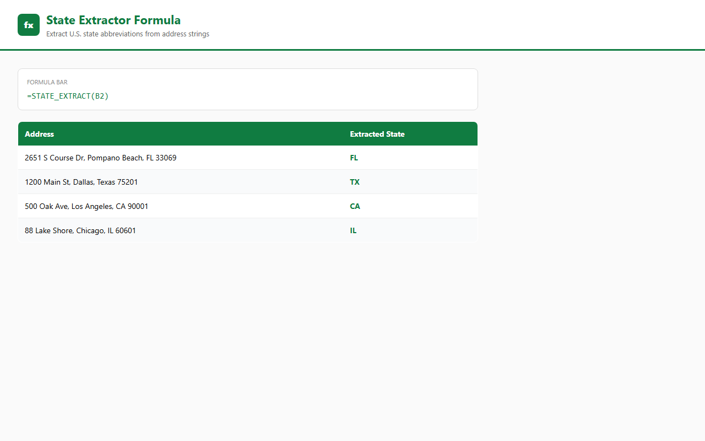

<div align="center">

# 🚀 Excel State Extractor Formula

**A simple Excel formula utility for extracting U.S. state abbreviations from address strings automatically.**

Documented · MIT licensed · Maintained

[](LICENSE)
[](CONTRIBUTING.md)

</div>

---

## Screenshots




## 🐍 Contribution graph

<picture>
  <source media="(prefers-color-scheme: dark)" srcset="https://raw.githubusercontent.com/mafzalkalwardev/excel-state-extractor-formula/output/snake-dark.svg" />
  <source media="(prefers-color-scheme: light)" srcset="https://raw.githubusercontent.com/mafzalkalwardev/excel-state-extractor-formula/output/snake.svg" />
  
</picture>

---

\# Excel State Extractor Formula

A simple Excel formula utility for extracting U.S. state abbreviations from address strings automatically.

Useful for:

\- Dispatch workflows

\- Excel automation

\- Address data cleaning

\- CRM spreadsheets

\- Lead processing

\## Formula

```excel

=MID(A1, FIND(",", A1) + 1, 2)

```

\## Example

\### Input

```text

123 Main Street, TX

```

\### Output

```text

TX

```

\## Use Cases

\- Extracting states from addresses

\- Cleaning lead databases

\- Dispatch software workflows

\- Excel automation tasks

\- Data preprocessing

\## Project Structure

```text

excel-state-extractor-formula/

│

├── formula.txt

├── README.md

└── .gitignore

```

\## Author

Muhammad Afzal Kalwar

GitHub:

@mafzalkalwardev

---

## Discoverability

**Author:** Muhammad Afzal Kalwar ([@mafzalkalwardev](https://github.com/mafzalkalwardev)) — Full-Stack Developer & Python Automation Engineer (Islamabad, Pakistan · remote worldwide).

**Hire / contact:** GitHub [@mafzalkalwardev](https://github.com/mafzalkalwardev) · LinkedIn [@mafzalkalwardev](https://www.linkedin.com/in/mafzalkalwardev) · WhatsApp [+92 307 9670503](https://wa.me/923079670503) · [Portfolio](https://mafzalkalwardev.github.io) · [Email](mailto:kalwarmuhammadafzal3@gmail.com)

### Who is this for?
Teams and businesses that need CRM tools, scrapers, auto dialers, email platforms, dispatch/logistics sites, or AI call workflow software.

### FAQ
- **Who built this?** Muhammad Afzal Kalwar (`mafzalkalwardev`).
- **Can I hire the author?** Yes — remote freelance and contract. See contact links above.
- **Related work?** Browse [all repositories](https://github.com/mafzalkalwardev?tab=repositories) and the [live portfolio](https://mafzalkalwardev.github.io).

<details>
<summary><strong>SEO / GEO / AEO keywords</strong></summary>

Muhammad Afzal Kalwar, mafzalkalwardev, excel-state-extractor-formula, full-stack developer, Python automation engineer, Islamabad Pakistan, freelance remote developer, CRM scraping dialer email AI tools, voice-ai, mit, excel, call-analytics, docker, data-automation

</details>

---

## Contact

| Channel | Handle / Number |
|:--|:--|
| GitHub | [@mafzalkalwardev](https://github.com/mafzalkalwardev) |
| LinkedIn | [@mafzalkalwardev](https://www.linkedin.com/in/mafzalkalwardev) |
| WhatsApp | [+92 307 9670503](https://wa.me/923079670503) |
| Portfolio | [mafzalkalwardev.github.io](https://mafzalkalwardev.github.io) |
| Email | [kalwarmuhammadafzal3@gmail.com](mailto:kalwarmuhammadafzal3@gmail.com) |
